  

# 🚀 Awesome Release Management & Deployment Tracking

  
  
  
  
  

> 🌟 **A curated directory of top Release Management and Deployment Tracking platforms** — exploring both enterprise SaaS/Hosted commercial powerhouses and battle-tested open-source alternatives for orchestrating release pipelines, tracking multi-environment deployments, progressive delivery, canary releases, and enforcing DevSecOps governance.

---

## 📋 Table of Contents

- [🌐 Sector Overview & Market Dynamics](#-sector-overview--market-dynamics)
- [🟦 SaaS / Hosted Platforms](#-saas--hosted-platforms)
  - [Enterprise SaaS Feature & Pricing Matrix](#enterprise-saas-feature--pricing-matrix)
  - [SaaS Platform Deep-Dives](#saas-platform-deep-dives)
- [🟩 Open-Source Software](#-open-source-software)
  - [Open-Source Solutions by Community Stars](#open-source-solutions-by-community-stars)
  - [Open-Source Software Deep-Dives](#open-source-software-deep-dives)
- [📊 Comparison at a Glance](#-comparison-at-a-glance)
- [🤝 Contributing](#-contributing)
- [⭐ Star History](#-star-history)
- [📄 License](#-license)

---

## 🌐 Sector Overview & Market Dynamics

The global Application Release Orchestration (ARO) and Continuous Delivery market is estimated at approximately **$3.8 billion to $4.5 billion**, rapidly expanding at an estimated **18–22% CAGR** driven by Kubernetes adoption, GitOps workflows, and cloud-native DevSecOps maturity.

The sector exhibits **moderate fragmentation with bipolar consolidation**: hyperscalers and end-to-end dev platforms (Microsoft Azure DevOps, GitLab) dominate baseline CI/CD pipeline infrastructure, while best-of-breed specialized vendors (LaunchDarkly in feature release management, Harness in intelligent release orchestration, Octopus Deploy in multi-cloud deployment automation) command high-value enterprise niches, preventing a single winner-take-all monopoly.

---

## 🟦 SaaS / Hosted Platforms

Commercial, cloud-hosted Release Management and Deployment Tracking platforms providing automated release gating, environment orchestration, and compliance auditing.

### Enterprise SaaS Feature & Pricing Matrix

*Sorted in descending order by company scale (market capitalization / valuation / annual revenue).*

| Platform | Company Scale (Valuation / Revenue) | Starting Tier Price | Free Tier Limits / Trial Limits | Key Capabilities |
| :--- | :--- | :--- | :--- | :--- |
| **Azure Pipelines** | **~$3.1 Trillion** (Microsoft Market Cap) | **$40/month** per concurrent self-hosted pipeline; **$40/month** per MS-hosted job | **Free forever plan**: 1 Microsoft-hosted job with 1,800 free minutes/month (60-minute max job duration) + 1 self-hosted job with unlimited minutes | Deployment gates, Application Insights continuous monitoring, approval checks, enterprise role-based access. |
| **GitLab Release Management** | **~$8.5 Billion** (GitLab Inc. Market Cap) | **$29/user/month** (GitLab Premium plan, billed annually) | **Free forever plan**: 5 users per namespace, 400 compute CI/CD minutes/month, and 5 GB storage | Integrated release orchestration, deploy freezes via cron schedules, release milestone association, generic packages. |
| **LaunchDarkly** | **~$3.0 Billion** (Valuation, ~$100M+ ARR) | **$10/user/month** (Starter tier for up to 5 members; Pro at $20/user/month) | **14-day free trial**: Full access up to 10,000 monthly active users (MAUs), unlimited flags, and progressive rollouts | Release Autopilot risk scoring, sub-200ms global flag propagation, progressive rollouts, instant blast-radius rollbacks. |
| **CloudBees Feature Management** | **~$1.0 Billion** (Valuation, ~$150M+ ARR) | **$18/user/month** (Starter package) | **14-day free trial**: Full feature flagging capabilities, up to 15 seats, and 1,000,000 monthly flag impressions | Decoupled feature control plane, real-time toggle kill-switches, Git-native release approvals, regulatory audit trails. |
| **Octopus Deploy** | **~$1.0 Billion** (Valuation, ~$80M+ ARR) | **$10/target/month** (Standard Cloud tier, minimum 10 targets = $100/mo) | **30-day free trial**: Up to 10 deployment targets, 5 concurrent deployments, and unlimited users | Immutable release snapshots, guided failure interventions, environment lifecycles, SemVer release notes integration. |
| **Harness Release Orchestration** | **~$3.7 Billion** (Valuation, ~$100M+ ARR) | **$100/service/month** (Enterprise tier orchestration module) | **Free forever plan**: Up to 2 service instances, 5 pipeline runs/day, and 1 concurrent deployment step | Reusable phase blueprints, Release Calendar, automated pipeline activities, downloadable compliance-grade Excel reports. |
| **CircleCI Smart Deployments** | **~$1.7 Billion** (Valuation, ~$100M+ ARR) | **$15/month** (Standard plan including 5 user seats + 30,000 credits/mo) | **Free forever plan**: 6,000 build credits/month, up to 30 concurrent jobs, and unlimited users | Deploy markers, automated release validation, environment version hierarchy, K8s progressive delivery via Argo Rollouts. |

---

### SaaS Platform Deep-Dives

#### 🐙 Octopus Deploy
* **Type:** Release orchestration with immutable releases and lifecycle governance
* **Overview:** Octopus Deploy treats a **release as an immutable snapshot** of the deployment process, variable values, package versions, and channel, ensuring what worked in Test runs identically in Production. **Lifecycles** govern progression through environments with phases, automatic/manual deployments, and progression gate rules. **Guided failures** pause deployments for safe manual intervention (fail, retry, ignore, or exclude node).
* **Target Audience:** Organizations needing enterprise-grade release orchestration with immutable releases, multi-environment lifecycle governance, and compliance audit trails.

#### 🦊 GitLab Release Management
* **Type:** Integrated releases within unified DevSecOps platform
* **Overview:** GitLab embeds releases into its integrated CI/CD platform, providing release evidence, milestone tracking, and deploy freezes. **Deploy freezes** prevent accidental production deployments during critical business or blackout windows using crontab-defined schedules with `$CI_DEPLOY_FREEZE`. Features include generic package hosting, Review Apps, progressive delivery, and Canary deployments.
* **Target Audience:** Teams already using GitLab desiring unified release governance, milestone tracking, and deploy freezes without external orchestration tools.

#### ⚡ LaunchDarkly
* **Type:** Feature flag-based release control with automated rollback
* **Overview:** LaunchDarkly's **Release Autopilot** scores pull-request risk, injects feature flags into risky changes, and triggers multi-environment release plans post-merge. If regressions appear, deployments roll back instantaneously. Handles **70+ trillion daily flag evaluations** with **<200ms global edge propagation** and a **99.99% uptime SLA** backed by SOC 2, ISO 27001, and FedRAMP compliance.
* **Target Audience:** Modern engineering teams wanting release control decoupled from binary deployments, progressive rollouts, and instant blast-radius remediation.

#### 🐝 CloudBees Feature Management
* **Type:** Feature flag control plane with enterprise governance
* **Overview:** CloudBees decouples binary deployment from customer exposure via an enterprise feature control plane. Toggles can disable underperforming features in seconds without redeploying code. Provides Git-native release controls, comprehensive auditability, and single-pane visibility across multi-team release trains.
* **Target Audience:** Organizations seeking an enterprise feature management control plane integrated with existing DevOps CI/CD toolchains with stringent regulatory compliance.

#### ☁️ Azure Pipelines
* **Type:** CI/CD with continuous monitoring and deployment gates
* **Overview:** Azure Pipelines seamlessly connects with Application Insights for **continuous monitoring**, automatically evaluating health alerts and release gates. Releases promote automatically when health signals stabilize or halt when thresholds are exceeded. Includes granular role-based access control and native Azure resource integration.
* **Target Audience:** Microsoft-centric enterprises needing CI/CD pipelines with native Application Insights telemetry, deployment gates, and strict enterprise compliance.

#### 🎯 CircleCI Smart Deployments
* **Type:** Deploy markers with automated rollback and release validation
* **Overview:** CircleCI **Smart Deployments** combines deploy markers, rollback pipelines, and post-deployment release validation. **Deploy markers** track versions across environments with version promotion paths. The **release agent** integrates with Argo Rollouts on Kubernetes for progressive canary delivery, metric analysis, and automated rollback upon anomaly detection.
* **Target Audience:** Teams utilizing CircleCI who want deployment tracking, automated rollback validation, and version promotion without introducing third-party tools.

#### 🛡️ Harness Release Orchestration
* **Type:** Enterprise release orchestration with visual process modeling
* **Overview:** Harness provides a structured framework for modeling, scheduling, and orchestrating complex releases across distributed teams and heterogeneous environments. **Processes** are reusable blueprints composed of build, test, and deployment phases. Features include a Release Calendar, automated approvals, ad-hoc release paths, and audit-ready Excel reports.
* **Target Audience:** Large enterprises requiring multi-tier release orchestration with visual pipeline modeling, scheduled release trains, and compliance audits.

---

## 🟩 Open-Source Software

Self-hosted, community-driven Release Management and Deployment Tracking tools spanning **GitOps continuous delivery**, **progressive rollout controllers**, **CDEvents intelligence**, and **DORA metrics analytics platforms**.

### Open-Source Solutions by Community Stars

*Sorted in descending order by GitHub stargazer count.*

| Project | GitHub Stars Badge | Primary Stack | License | Core Focus |
| :--- | :--- | :--- | :--- | :--- |
| **Argo CD** |  | Go / Kubernetes | Apache 2.0 | Declarative GitOps continuous delivery & environment sync for Kubernetes |
| **Spinnaker** |  | Java / Python / Go | Apache 2.0 | Enterprise multi-cloud continuous delivery & automated blue/green pipelines |
| **Flux CD** |  | Go / Kubernetes | Apache 2.0 | Open and extensible progressive GitOps continuous delivery toolkit for Kubernetes |
| **Woodpecker CI** |  | Go / Docker | Apache 2.0 | Community fork of Drone CI with automated deployment steps and matrix pipelines |
| **Werf** |  | Go / Helm / K8s | Apache 2.0 | GitOps CLI tool integrating container building, deployment tracking, and rollbacks |
| **Argo Rollouts** |  | Go / Kubernetes | Apache 2.0 | Progressive delivery controller supporting Blue/Green, Canary, and metric analysis |
| **Apache DevLake** |  | Go / Python / Grafana | Apache 2.0 | Open-source dev data platform analyzing delivery lifecycle & DORA metrics |
| **Keptn** |  | Go / Kubernetes | Apache 2.0 | Cloud-native application lifecycle orchestration with SLO-driven release evaluations |
| **PipeCD** |  | Go / TypeScript | Apache 2.0 | Unified GitOps continuous delivery system for Kubernetes, Serverless, and Terraform |
| **Canary Checker** |  | Go / Kubernetes | Apache 2.0 | Health check platform validating releases across infrastructure and application layers |
| **CDviz** |  | Rust / PostgreSQL / Grafana | Apache 2.0 | CDEvents standard-native deployment intelligence and DORA indicators visualization |

---

### Open-Source Software Deep-Dives

#### 🐙 [Argo CD](https://github.com/argoproj/argo-cd) 
* **Stack:** Go / Kubernetes | **License:** Apache 2.0
* **Overview:** Declarative GitOps continuous delivery engine for Kubernetes. Argo CD tracks live cluster state against desired state specified in Git repositories. Features sophisticated version tracking strategies (SemVer ranges, Git tag pinning, branch tracking, and prefixed tag hierarchies for monorepos), automated health status checks, and self-healing cluster synchronization.
* **Best for:** Kubernetes engineering teams demanding GitOps-native automated continuous delivery and multi-cluster environment tracking.

#### 🚢 [Spinnaker](https://github.com/spinnaker/spinnaker) 
* **Stack:** Java / Python / Go / Kubernetes | **License:** Apache 2.0
* **Overview:** Enterprise battle-tested multi-cloud continuous delivery platform created by Netflix and Google. Spinnaker monitors container registries for image releases and triggers automated pipelines across AWS EC2, GCP, Azure, and Kubernetes. Provides built-in blue/green, canary analysis via Kayenta, and cluster management.
* **Best for:** Large enterprise organizations needing multi-cloud delivery pipelines with automated canary evaluation and immutable infrastructure rollouts.

#### 🔄 [Flux CD](https://github.com/fluxcd/flux2) 
* **Stack:** Go / Kubernetes | **License:** Apache 2.0 (CNCF Graduated)
* **Overview:** A modular set of continuous and progressive delivery controllers for Kubernetes. Flux keeps clusters synchronized with Git repositories, OCI artifacts, and Helm repositories, automatically detecting new image tags and committing updates back to Git.
* **Best for:** Teams looking for a lightweight, modular, security-hardened GitOps engine with automated image update commits.

#### 🐦 [Woodpecker CI](https://github.com/woodpecker-ci/woodpecker) 
* **Stack:** Go / Docker | **License:** Apache 2.0
* **Overview:** A community-maintained container-native CI/CD engine forked from Drone CI. Woodpecker executes every pipeline step inside isolated containers with simple YAML syntax, native deployment triggers, matrix builds, and multi-architecture runner support.
* **Best for:** Developers looking for a lightweight, self-hosted CI/CD and deployment runner that can be deployed anywhere via Docker.

#### ⚙️ [Werf](https://github.com/werf/werf) 
* **Stack:** Go / Helm / Kubernetes | **License:** Apache 2.0
* **Overview:** An Open-Source CLI tool that glues Git, container builders, Helm, and Kubernetes together. Werf tracks release states, validates deployment status in real time, provides distributed cache for build layers, and executes automatic rollbacks if pods fail readiness probes.
* **Best for:** Teams seeking a seamless CLI-driven bridge connecting source code, container assembly, and production Helm releases.

#### 📈 [Argo Rollouts](https://github.com/argoproj/argo-rollouts) 
* **Stack:** Go / Kubernetes | **License:** Apache 2.0
* **Overview:** Kubernetes controller providing advanced progressive delivery capabilities such as Blue/Green, Canary, Canary analysis, experimentation, and progressive traffic routing against ingress controllers and service meshes (Istio, NGINX, ALB).
* **Best for:** Teams deploying to Kubernetes needing automated canary rollouts, traffic shifting, and automatic metric rollback integration.

#### 📊 [Apache DevLake](https://github.com/apache/incubator-devlake) 
* **Stack:** Go / Python / PostgreSQL / Grafana | **License:** Apache 2.0
* **Overview:** Open-source developer data platform under the Apache Software Foundation. DevLake aggregates data across GitHub, GitLab, Jira, Jenkins, and SonarQube to calculate engineering efficiency metrics, deployment frequency, change lead time, and DORA indicators via pre-configured Grafana dashboards.
* **Best for:** Engineering leaders seeking automated software delivery analytics, team velocity dashboards, and standardized DORA metric benchmarks.

#### 🎛️ [Keptn](https://github.com/keptn/keptn) 
* **Stack:** Go / Kubernetes | **License:** Apache 2.0 (CNCF Incubating)
* **Overview:** A cloud-native lifecycle orchestrator for cloud-native applications. Keptn provides automated pre-deployment and post-deployment validation, evaluation of Service Level Objectives (SLOs), and automatic multi-stage release promotion.
* **Best for:** Organizations adopting SLO-driven release gates and automated progressive quality evaluations.

#### 🚰 [PipeCD](https://github.com/pipe-cd/pipecd) 
* **Stack:** Go / TypeScript | **License:** Apache 2.0
* **Overview:** Unified GitOps continuous delivery system designed for multiple application architectures including Kubernetes, AWS Lambda, Cloud Run, and Terraform. Includes automated drift detection, canary rollouts, and rich deployment metrics.
* **Best for:** Polyglot infrastructure environments deploying Kubernetes services alongside serverless functions and Terraform stacks under one pane of glass.

#### 🩺 [Canary Checker](https://github.com/flanksource/canary-checker) 
* **Stack:** Go / Kubernetes | **License:** Apache 2.0
* **Overview:** A Kubernetes-native health check and synthetic testing platform designed to validate deployments across infrastructure, databases, and APIs. Integrates into deployment pipelines to ensure newly released software passes synthetic sanity checks before receiving traffic.
* **Best for:** Teams needing automated post-deployment synthetic validation and health scoring across heterogeneous endpoints.

#### 🔍 [CDviz](https://github.com/cdviz-dev/cdviz) 
* **Stack:** Rust / PostgreSQL / Grafana | **License:** Apache 2.0
* **Overview:** Deployment intelligence platform standardizing software delivery telemetry using the CD Foundation's **CDEvents standard**. Collects and links events from GitHub, GitLab, Jenkins, ArgoCD, and Kubernetes into PostgreSQL with ready-made Grafana dashboards tracking DORA indicators, deployment history, and pipeline health.
* **Best for:** Teams wanting an open-source, vendor-neutral CDEvents platform for deployment tracking and DORA metrics with full data ownership.

---

## 📊 Comparison at a Glance

| Solution | Model | Stack | Release Orchestration | Deployment Tracking | DORA Metrics | Self-Hosted Option | Best For |
| :--- | :--- | :--- | :--- | :--- | :--- | :--- | :--- |
| **Octopus Deploy** | SaaS / Commercial | Cloud / Windows / Linux | ✅ Immutable releases | ✅ Environments & Lifecycles | ✅ Native Insights | ✅ (Self-managed) | Enterprise release governance & lifecycle policies |
| **GitLab** | SaaS / Commercial | Ruby / Go / Cloud | ✅ Integrated pipelines | ✅ Deploy freezes & Milestones | ✅ Value Stream Analytics | ✅ (Self-managed) | All-in-one DevSecOps platform |
| **Harness** | SaaS / Commercial | Cloud Native | ✅ Visual process modeling | ✅ Release calendars & groups | ✅ Built-in DORA | ❌ (SaaS focused) | Multi-team enterprise release orchestration |
| **LaunchDarkly** | SaaS / Commercial | Multi-region Cloud | ✅ Flag-driven Autopilot | ✅ Real-time deploy events | ❌ (Observability integrations) | ❌ | High-frequency progressive delivery & instant rollbacks |
| **CloudBees** | SaaS / Commercial | Cloud Native | ✅ Feature release control | ✅ Audit trail governance | ❌ (CI analytics) | ❌ | Enterprise feature management & compliance |
| **Azure Pipelines** | SaaS / Commercial | Azure Cloud | ✅ Multi-stage pipelines | ✅ Deployment gates & telemetry | ✅ PowerBI / Analytics | ✅ (Self-hosted agents) | Microsoft Azure-centric continuous delivery |
| **CircleCI** | SaaS / Commercial | Cloud Native | ✅ Smart Deployments | ✅ Deploy markers & hierarchy | ❌ (Insights API) | ✅ (Server edition) | Fast automated rollbacks & K8s rollouts |
| **Argo CD** | Open-Source | Go / Kubernetes | ⚠️ (Sync waves / Hooks) | ✅ GitOps state & tags | ❌ (Via integrations) | ✅ 100% Free OSS | Kubernetes declarative GitOps delivery |
| **Spinnaker** | Open-Source | Java / Kubernetes | ✅ Multi-cloud pipelines | ✅ Automated image triggers | ⚠️ (Via Kayenta) | ✅ 100% Free OSS | Complex multi-cloud enterprise deployments |
| **Flux CD** | Open-Source | Go / Kubernetes | ⚠️ (Kustomize/Helm reconciler) | ✅ Git & OCI artifact sync | ❌ | ✅ 100% Free OSS | Modular GitOps automation & image updates |
| **Argo Rollouts** | Open-Source | Go / Kubernetes | ✅ Progressive canary flows | ✅ Step-by-step rollout status | ⚠️ (Metric analysis) | ✅ 100% Free OSS | Advanced Kubernetes traffic-shifting & canary tests |
| **Apache DevLake** | Open-Source | Go / Postgres / Grafana | ❌ (Analytics only) | ✅ Polling dev tool events | ✅ 4 DORA indicators | ✅ 100% Free OSS | Engineering productivity & DORA intelligence |
| **CDviz** | Open-Source | Rust / Postgres / Grafana | ⚠️ (Event triggers) | ✅ CDEvents protocol tracking | ✅ 4 DORA indicators | ✅ 100% Free OSS | Standardized CDEvents deployment intelligence |

---

## 🤝 Contributing

Contributions are warmly welcome! If you know of an outstanding open-source Release Management or Deployment Tracking tool that belongs here, please feel free to submit a pull request:

1. 🍴 Fork the repository.
2. 🌿 Create your feature branch (`git checkout -b feature/awesome-tool`).
3. 📝 Add your project with description, technology stack, license, and star badge.
4. 🚀 Commit your changes (`git commit -m 'Add awesome tool'`).
5. 📤 Push to the branch (`git push origin feature/awesome-tool`).
6. 🎯 Open a Pull Request.

Please ensure the project is actively maintained with releases within the last 12 months.

---

##  Star History

---

## 📄 License

This repository is licensed under the [Creative Commons Zero v1.0 Universal](LICENSE) (CC0 1.0) Public Domain Dedication. Listed software projects retain their respective trademarks, copyrights, and licenses.

---

  ⭐ <b>If you find this directory helpful, please give it a star!</b> ⭐

